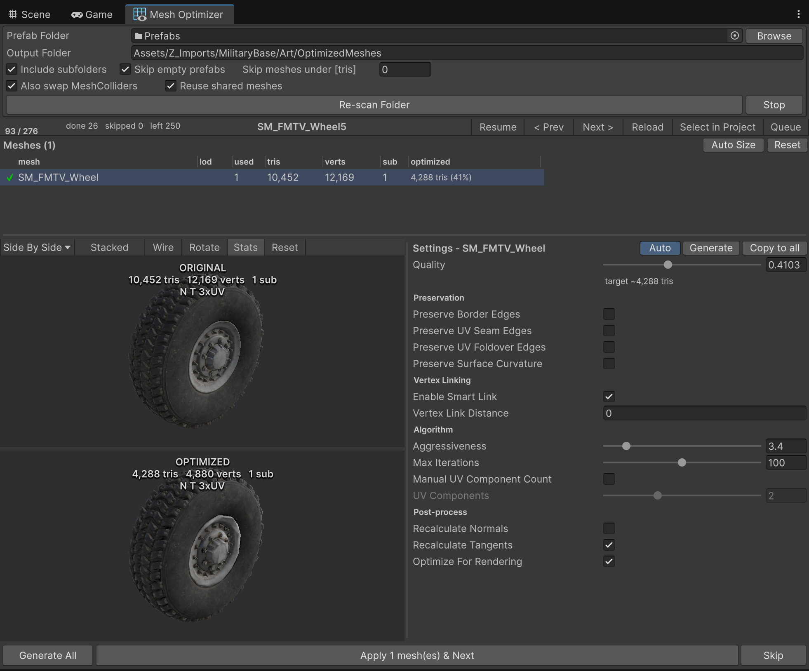

# Unity Mesh Optimizer

Interactive, prefab-by-prefab mesh optimizer for the Unity Editor.



Point it at a folder of prefabs and step through them: for each prefab you get every mesh it
uses with its stats, a live original/optimized preview, the full simplifier option set, and the
prefab's LOD setup. When a result looks right, **Apply** writes the optimized meshes, re-points
the prefab and moves to the next one.

## Requirements

- Unity 6000.0 or newer.
- [UnityMeshSimplifier](https://github.com/Whinarn/UnityMeshSimplifier) — the simplification
  algorithm itself. Unity cannot express a git dependency in `package.json`, so add it to your
  project's `Packages/manifest.json` yourself:

  ```json
  "com.whinarn.unitymeshsimplifier": "https://github.com/Whinarn/UnityMeshSimplifier.git#v3.1.0"
  ```

  Without it the package will not compile.

## Installation

Window ▸ Package Manager ▸ **+** ▸ *Install package from git URL…*

## Usage

Open **Window ▸ Asset Management ▸ Mesh Optimizer**, or right-click a folder in the Project
window and choose **Optimize Prefab Meshes…**.

1. Pick the prefab folder. The output folder defaults to `<folder>/OptimizedMeshes` and is editable.
2. **Start Optimizing** builds the queue. `Skip meshes under [tris]` keeps trivial meshes out of it.
3. Select a mesh, tune the settings, watch the preview. Generation runs on a worker thread and
   only kicks off once you release a slider.
4. **Apply … & Next** writes the meshes, re-points the prefab and advances. **Skip** moves on
   without touching anything.

### Notes on the settings

- **Preserve UV Seam Edges** is the usual reason a mesh refuses to shrink: on hard-surface props
  with per-face UVs almost every edge is a seam, so quality stops having any effect. The window
  detects this and offers to unlock it.
- **Preserve Border Edges** protects planes, fences and cards; unlocking it erodes their silhouette.
- **Recalculate Tangents** is on by default; **Recalculate Normals** is off, because rebuilding
  normals averages across hard edges and flattens hard-surface shading.

## Data

State that matters to the whole project lives in `ProjectSettings/MeshOptimizer.json`
(git-friendly plain JSON):

- which source mesh produced which optimized asset, and the settings used so a mesh shared by
  several prefabs is generated once, and re-tuning overwrites that asset
- per-prefab progress (applied/skipped), keyed by GUID so it survives renames.

Per-user preferences (folders, pane sizes, column widths, queue position) live in `EditorPrefs`.


## TODO

- Child mesh deletion (like deleting sub parts of a whole car mesh if not needed)

- prefab right click: open with mesh optimizer


- add revert button on mesh if opt added, with working ctrl z
- does it needs mesh readable false for performance? 


I remember wrote a feature and you implemented but not working: when program generate a mesh with some settings, it should store that data at ram so if I try to get that mesh again, does not regenerate: just gives the data at the ram.
Reason I want this: I open a mesh with very much vertex (so it takes much time) I open "preserve border edges", not sure about view, turn of, then not sure, turn on again etc. I want to see the mesh with that option open/close and combinations with other settings. currently every change taking time. so: store the generated until I switch to new mesh